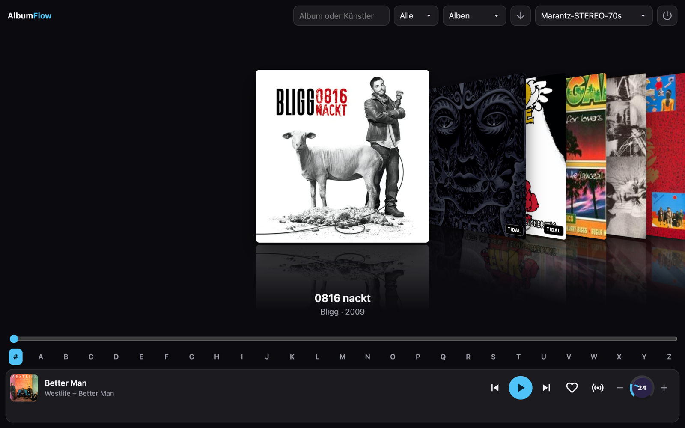

# AlbumFlow for Lyrion Music Server (beta)

A touch-friendly web interface for [Lyrion Music Server](https://lyrion.org) (LMS) built around a 3D album flow: swipe through your covers, tap one to flip it and see the tracks, play with one tap.



> **Beta.** This is the first public test version. Feedback, bug reports and ideas are very welcome: join the discussion in the **[Lyrion forum thread](https://forums.lyrion.org/forum/user-forums/3rd-party-software/1843884-announce-beta-albumflow-%E2%80%93-touch-web-interface-with-a-3d-album-flow)** or open a GitHub issue.

## Features

- 3D album flow with reflections, A–Z jump bar and position slider; swipe, mouse wheel or arrow keys
- Tap the centre cover to flip it and see the tracks; play, add or insert the whole album or a single track
- Collections: albums, **artists** (one tile per artist, tap to see their albums), albums by artist, recently added, playlists
- Search by album or artist
- Player selection, volume, play/pause/skip, power, large now-playing view (also as a screensaver)
- **Any source in the flow:** *My Music* (your local files), every music service plugin you have installed (Qobuz, Spotify via Spotty, Deezer, YouTube, …) and *All* (the whole library). For a service its top folders appear under *Collection*; folders open in the flow, albums and playlists flip and play like albums
- **TIDAL extras** (with the official TIDAL plugin, nothing patched): favourite tracks in date-added order, your playlists, mixes, suggestions, full TIDAL search, track radio, heart button to add/remove favourites
- English and German interface (follows the browser language)
- Embeddable: transparent "glass" theme for dashboards such as Home Assistant (see below)
- Single self-contained page, no build step, no extra dependencies

## Installation

AlbumFlow is a normal LMS plugin.

1. In Lyrion open **Settings → Plugins** and scroll to the bottom.
2. Add this repository URL under *Additional repositories*:
   ```
   https://raw.githubusercontent.com/trufy/AlbumFlow/main/repo.xml
   ```
3. Click *Apply*. **AlbumFlow (beta)** now appears in the plugin list. Enable it and restart Lyrion when asked.
4. Open `http://<your-server>:9000/AlbumFlow/` in a browser or on a tablet.

Updates arrive through the normal plugin update mechanism.

## Settings

**Settings → Advanced → AlbumFlow** → *Library*: which library *My Music* and *All* show. Choose a virtual library there, for example one without online duplicates; default is all tracks.

## URL parameters

| Parameter | Example | Meaning |
|---|---|---|
| `player` | `?player=Kitchen` | Preselect a player by name |
| `theme=glas` | `?theme=glas` | Transparent glass look without header brand, for embedding |
| `lang` | `?lang=en` | Interface language, `en` or `de` (default: browser language) |
| `idle` | `?idle=60` | Seconds without touch before the now-playing screensaver opens (glass theme only; `0` = off, default 30) |

## Home Assistant

AlbumFlow works nicely on a wall tablet as part of a Home Assistant dashboard, embedded with an iframe card and `?theme=glas` (Home Assistant and Lyrion must both be reached over http, or both over https, or the browser blocks the frame):


```yaml
type: iframe
url: http://<your-server>:9000/AlbumFlow/index.html?theme=glas&player=<player name>
allow: autoplay
grid_options:
  columns: full
  rows: 9
```

Happy to share the complete dashboard setup (glass theme, tablet layout): just ask in the forum thread or open an issue.

## Known limitations

- Generic service browsing has been tested with TIDAL, YouTube and Sounds & Effects only. Reports for Qobuz, Spotty, Deezer and others are especially welcome.
- Service search fields are not used yet; the search box filters what is shown in the flow (plus the full TIDAL catalogue for TIDAL).
- Other languages than English and German are welcome as contributions.
- Tested with Lyrion 9.x on Windows, TIDAL plugin 1.10, Chrome/Safari/Android WebView.

## Feedback

- [Lyrion forum thread](https://forums.lyrion.org/forum/user-forums/3rd-party-software/1843884-announce-beta-albumflow-%E2%80%93-touch-web-interface-with-a-3d-album-flow)
- [GitHub issues](https://github.com/trufy/AlbumFlow/issues): please include your Lyrion version, browser/device and, for TIDAL issues, the TIDAL plugin version.

## Licence

GPL-2.0, like Lyrion Music Server. See [LICENSE](LICENSE).
