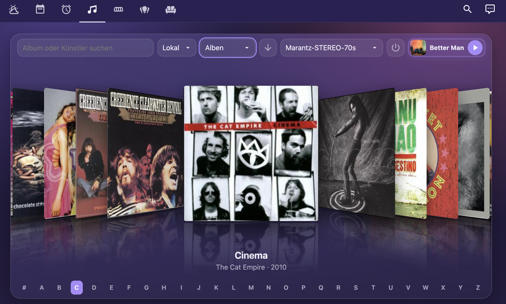

# AlbumFlow for Lyrion Music Server (beta)

A touch-friendly web interface for [Lyrion Music Server](https://lyrion.org) (LMS) built around a 3D album flow: swipe through your covers, tap one to flip it and see the tracks, play with one tap.


> **Beta.** This is the first public test version. Feedback, bug reports and ideas are very welcome. See [Feedback](#feedback).

## Features

- 3D album flow with reflections, A–Z jump bar and position slider; swipe, mouse wheel or arrow keys
- Tap the centre cover to flip it and see the tracks; play, add or insert the whole album or a single track
- Collections: albums, by artist, newest, tracks, playlists
- Search by album or artist
- Player selection, volume, play/pause/skip, power, large now-playing view (also as a screensaver)
- Local library and **TIDAL** (via the official TIDAL plugin): favourite tracks in date-added order, your playlists, mixes, suggestions, full TIDAL search, track radio, heart button to add/remove favourites
- Embeddable: transparent "glass" theme for dashboards such as Home Assistant (see below)
- Single self-contained page, no build step, no extra dependencies

## Installation

AlbumFlow is a normal LMS plugin.

1. In Lyrion open **Settings → Plugins** and scroll to the bottom.
2. Add this repository URL under *Additional repositories*:
   ```
   https://raw.githubusercontent.com/trufy/AlbumFlow/main/repo.xml
   ```
3. Click *Apply*. **AlbumFlow (beta)** now appears in the plugin list. Enable it and restart Lyrion when asked.
4. Open `http://<your-server>:9000/AlbumFlow/` in a browser or on a tablet.

Updates arrive through the normal plugin update mechanism.

## Settings

**Settings → Advanced → AlbumFlow** has two optional TIDAL tweaks. Both are **off by default** because they patch the TIDAL plugin at runtime; changes take effect after a Lyrion restart.

| Option | What it does |
|---|---|
| TIDAL: downgrade stream instead of transcoding | Fixes TIDAL tracks cutting out after ~50 s on older hardware (Squeezebox Boom / Classic). Players that can't play Hi-Res get a LOSSLESS stream directly instead of a transcoding pipeline. |
| TIDAL: show AI flag | Shows an "AI" badge on tracks TIDAL flags as AI generated. |

## URL parameters

| Parameter | Example | Meaning |
|---|---|---|
| `player` | `?player=Kitchen` | Preselect a player by name |
| `theme=glas` | `?theme=glas` | Transparent glass look without header brand, for embedding |
| `idle` | `?idle=60` | Seconds without touch before the now-playing screensaver opens (glass theme only; `0` = off, default 30) |

## Home Assistant

AlbumFlow works nicely on a wall tablet as part of a Home Assistant dashboard, embedded with an iframe card and `?theme=glas` (Home Assistant and Lyrion must both be reached over http, or both over https, or the browser blocks the frame):



```yaml
type: iframe
url: http://<your-server>:9000/AlbumFlow/index.html?theme=glas&player=<player name>
allow: autoplay
grid_options:
  columns: full
  rows: 9
```

Happy to share the complete dashboard setup (glass theme, tablet layout): just ask in the forum thread or open an issue.

## Known limitations

- The interface is currently German only; English (and other languages) will follow.
- Streaming services other than TIDAL are not browsable in the flow yet. Generic support for all services (Qobuz, Spotify, Deezer, …) and for several libraries is planned.
- Tested with Lyrion 9.x on Windows, TIDAL plugin 1.10, Chrome/Safari/Android WebView.

## Feedback

- Lyrion forum thread: *link follows*
- [GitHub issues](https://github.com/trufy/AlbumFlow/issues): please include your Lyrion version, browser/device and, for TIDAL issues, the TIDAL plugin version.

## Licence

GPL-2.0, like Lyrion Music Server. See [LICENSE](LICENSE).
